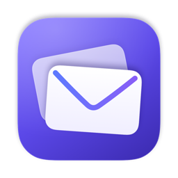
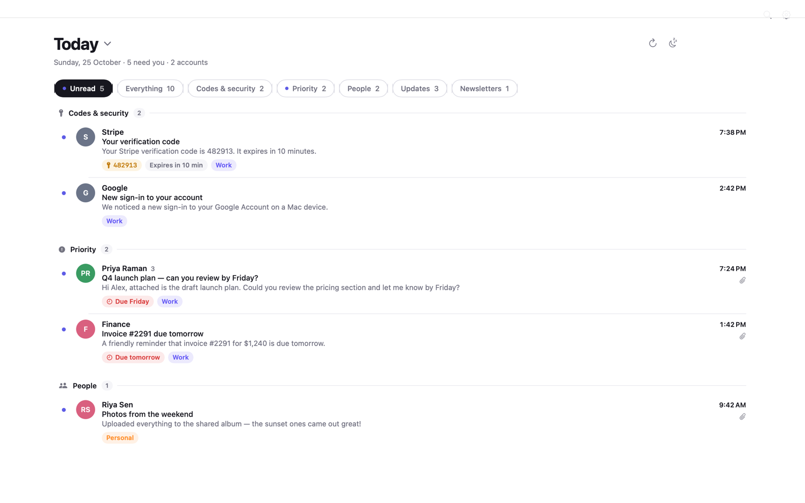
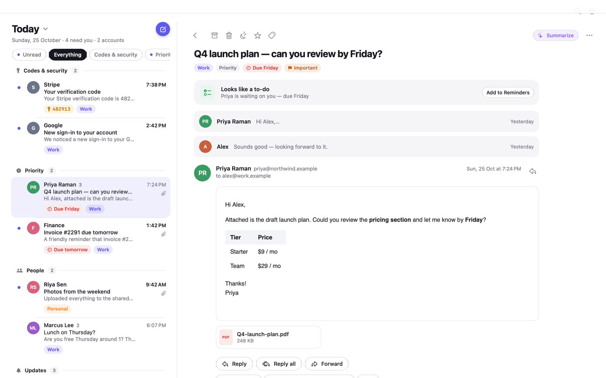
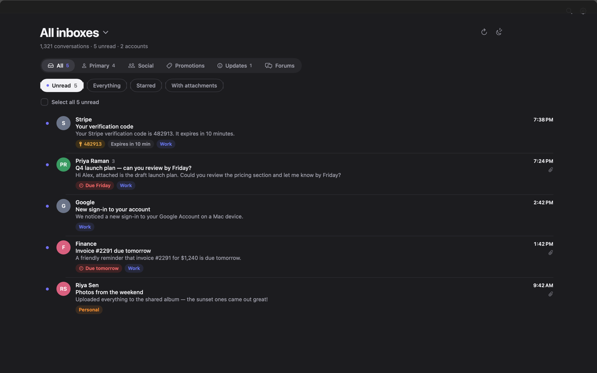

  

<h1 align="center">Emilo</h1>

  A calm, native Mac home for your Gmail. 
  Read it, handle it, move on.

  <a href="https://github.com/atanu-app/Emailo-public/releases/latest"><b>Download the latest version</b></a>
  · <a href="INSTALL.md">Install guide</a>
  · <a href="CHANGELOG.md">What's new</a>
  · <a href="https://github.com/atanu-app/Emailo-public/issues/new/choose">Report a problem</a>

---

Emilo is a Mac app for Gmail and Google Workspace. It talks directly to Gmail from your Mac — there are no Emilo servers, no ads and no tracking — and adds the things a busy inbox needs: a sorted Today view, alerts that stand out, tracker blocking and phishing warnings.

## Highlights

**Focus**
- **Today** — everything that arrived today, unread first, sorted on your Mac into Codes & security, Priority, People, Updates, Newsletters and Social.
- **Smart Unread** — Today and your Inbox open on Unread while there's unread mail, and switch to Everything once you're done.
- **Alerts** — failure and incident emails from monitoring and CI tools (PagerDuty, Datadog, Grafana, Sentry, AWS CloudWatch, Jenkins, GitHub Actions and more) are recognised, grouped and highlighted, with acknowledge and resolve.
- **Screener and Focus delivery** — hold mail from new senders until you approve them, and get new mail at set times.

**Safety and privacy**
- Remote images and tracking pixels are blocked until you allow them; link tracking is removed.
- **Phishing warnings** for lookalike senders, impersonation, deceptive links and failed sender checks.
- Links to anything other than a web page ask first.

**Everything Gmail does**
- All your folders and labels with counts, label management, Move to, inbox tabs (Primary, Social, Promotions…), search, snooze, send later, drafts, formatting, attachments, signatures, vacation replies and filters.
- Several Gmail and Workspace accounts side by side.

**Built for the Mac**
- Light and dark mode, Liquid Glass on macOS 26, keyboard shortcuts, a menu-bar item, Spotlight and Shortcuts.
- Quick replies, templates, follow-up reminders ("Waiting on"), share your availability from Calendar, bills and packages at a glance.

  
  

## Download and install

1. Download **Emilo-&lt;version&gt;.dmg** from the [latest release](https://github.com/atanu-app/Emailo-public/releases/latest).
2. Open it and drag **Emilo** to **Applications**.
3. Open Emilo. The first time, macOS may ask you to confirm — see [Install guide › First launch](INSTALL.md#first-launch).
4. Follow the in-app steps to connect your Google account ([details](docs/google-setup.md)).

**Requires** macOS 15 Sequoia or later, on Apple silicon or Intel.

Emilo checks for updates once a day and tells you when a new version is ready (Settings › General).

## Privacy

Emilo connects only to Google (Gmail and sign-in) and, for update checks, to this GitHub repository. Your mail, contacts and settings stay on your Mac and in your Google account. Read the full [privacy notice](PRIVACY.md).

## Help

- [Install guide](INSTALL.md) — installing, first launch, updating and removing Emilo
- [Connect your Google account](docs/google-setup.md)
- [Report a bug or request a feature](https://github.com/atanu-app/Emailo-public/issues/new/choose)
- [Security issues](SECURITY.md)

---

This repository hosts Emilo's releases and documentation; the source code is private. © 2026 Taking Care of Business LLC. See [LICENSE](LICENSE).
